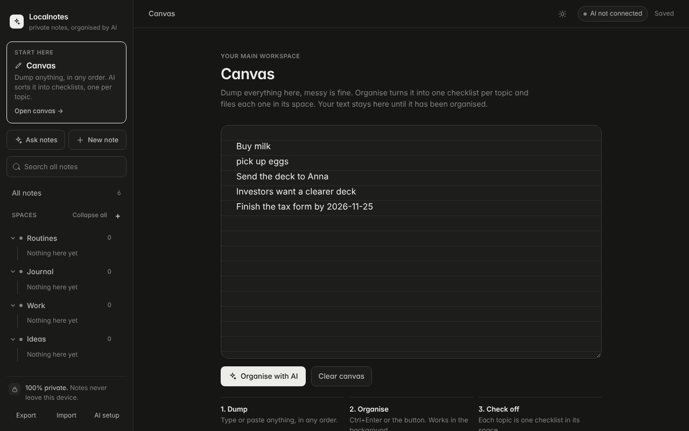

<div align="center">

# Localnotes

**Dump your messy thoughts. A local AI sorts them. Nothing ever leaves your computer.**

A private notes app in a single HTML file. No account, no cloud, no server, no install.

[](LICENSE)
[](#quick-start)
[](#why-trust-it)
[](#privacy)

[**Try it in 30 seconds**](#quick-start) · [Privacy](#privacy) · [Why trust it](#why-trust-it) · [Honest limits](#what-it-does-not-do-yet)

<br>

<br><br>



</div>

---

## Why Localnotes

Most notes apps want an account, a subscription and a copy of your thoughts on someone else's server. Localnotes takes the opposite approach:

- **Everything stays on your device.** Notes live in your browser. The AI runs on your machine through [Ollama](https://ollama.com).
- **One file.** The whole app is `index.html`. Read it, fork it, or run it from a USB stick.
- **Zero dependencies, zero build.** No npm, no bundler, no framework. Double-click and it runs.
- **The canvas is the main feature.** Write anything in any order. The AI groups the points by topic, creates one checklist per topic, and files it in a space.

## Quick start

```bash
git clone https://github.com/YOUR-USERNAME/localnotes.git
cd localnotes
python3 -m http.server 8000   # any static server works
```

Open **http://localhost:8000**. That's it.

Want the AI too? Install [Ollama](https://ollama.com), then:

```bash
ollama pull llama3.2
```

In Localnotes, open **AI setup** and press **Test connection**. Any model you have downloaded works. Cloud models are never used.

> You can also double-click `index.html`. Some features, including the AI, work best through a local server.

## Privacy

Localnotes is built so you don't have to trust a promise. You can check it.

| | Typical cloud notes app | **Localnotes** |
|---|---|---|
| Account needed | Yes | **No** |
| Where notes are stored | Vendor's servers | **Your browser, on your device** |
| AI processing | Vendor's cloud | **Your computer, through Ollama** |
| Network requests | Constant, to the vendor | **Only to the Ollama address you set** |
| Tracking or analytics | Usually | **None** |
| Works with the Wi-Fi off | Partly | **Yes** |

**Verify it yourself:**

```bash
python3 tests/suite7.py http://localhost:8000/index.html
```

This records every network request the app makes during a real session and fails if any of them leave your machine. Or open your browser's Network tab and use the app.

## Features

- **Canvas**: a blank sheet for brain-dumps. "Organise with AI" sorts points by topic, files them in spaces, and turns deadlines into reminders. Undo reverts it.
- **Ask your notes**: ask "what did I do last month on fundraising?" Answers come only from your notes, and each one lists the notes it used.
- **Reminders**: set a date on any note. A calendar on the home page shows what's coming up.
- **Rich text**: bold, italic, underline, headings, lists, checkboxes, colours, highlights and links.
- **Spaces**: collapsible folders in the sidebar. Click a name to see its notes.
- **Light and dark mode**, with your choice remembered.
- **Export and backup**: Markdown (one folder of `.md` files, or one file), encrypted backups, or plain JSON. Your notes are never locked in.

## Your data, your control

- **Encrypted backups** use AES-256-GCM, with a key derived from your passphrase by PBKDF2-SHA-256 (310,000 iterations). The browser's own crypto library does the work.
- **Markdown export** keeps your notes readable in any editor, with front matter for titles, spaces, dates and reminders.
- **Nothing is hidden.** It's one HTML file with no minified bundles. Anyone can read exactly what runs.

## Why trust it

- **Read it in one sitting.** The entire app is `index.html`.
- **Strict Content Security Policy.** Scripts and connections are limited to this page and your local Ollama address.
- **Note text is never rendered as HTML.** Titles, search results, chat answers and AI replies are escaped or written as plain text. Pasted and imported rich text passes through a whitelist that removes scripts.
- **Tested.** Six suites cover editing, canvas organising, the AI (against a stub), export and encryption, reminders, delete, reset, and the privacy check. Run them with the commands in [`tests/`](tests).
- **Security policy.** See [SECURITY.md](SECURITY.md) for the threat model and how to report a vulnerability.

## What it does not do yet

Stated plainly, so you can decide if it fits:

- **No sync between devices.** Your notes live in one browser on one computer.
- **No mobile app.** The page works in a phone browser but isn't designed for it.
- **Reminders appear only while the page is open.** There are no notifications.
- **Encryption covers backups only.** Notes are stored unencrypted in your browser on your computer.
- **Clearing site data deletes your notes.** Export a backup regularly.
- **Chrome and Edge are the tested browsers.** Folder export needs the File System Access API.
- **No images or attachments.** Text, checklists and links only.
- **Keyword search.** It doesn't understand synonyms, so use the words you wrote.
- **The AI was tested against a stub, not a real model.** The quality of answers from your model hasn't been measured.
- **Not audited.** It's a careful open project, not a reviewed product.

## How it's built

```
index.html          the whole app (HTML, CSS and JavaScript)
docs/               screenshots
tests/              Playwright suites, an Ollama stand-in, and sample data
SECURITY.md         threat model and reporting
LICENSE             MIT
```

Notes are stored in IndexedDB. The AI calls only `POST /api/generate` and `GET /api/tags` on the Ollama address you configure.

## Contributing

Pull requests are welcome, especially for:

- testing the AI against real models, and sharing what works well
- accessibility and keyboard support
- import and export formats
- translations

Before you open a PR, run the suites in [`tests/`](tests) and make sure the privacy check still passes.

## Licence

[MIT](LICENSE). Use it, change it, ship it.

---

<div align="center">

If Localnotes helps you think, a ⭐ helps others find it.

</div>
